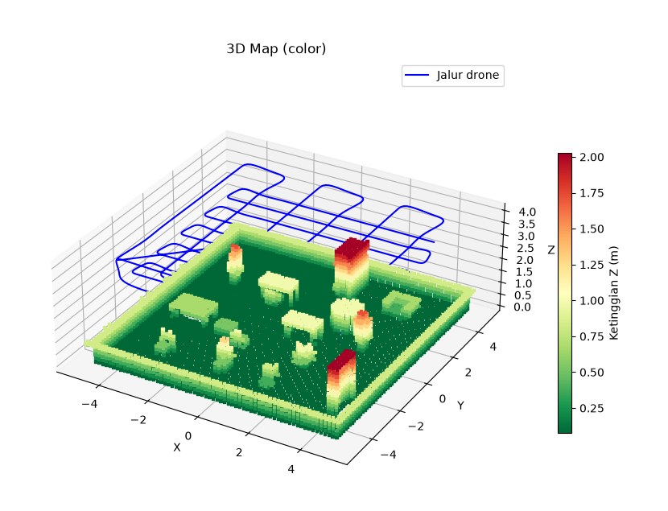
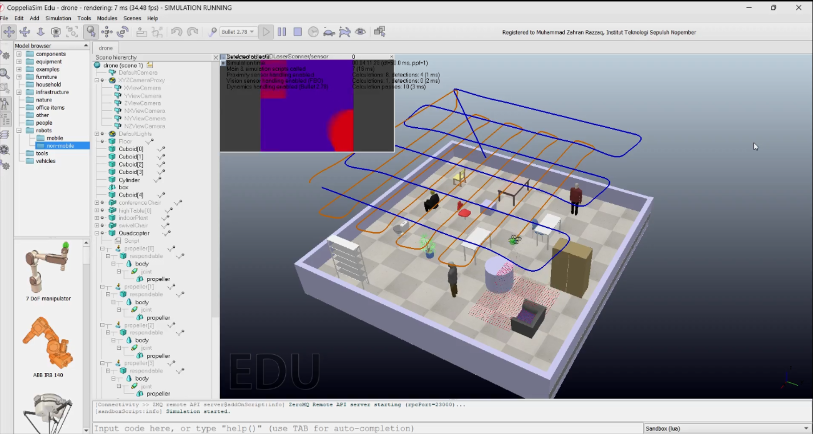
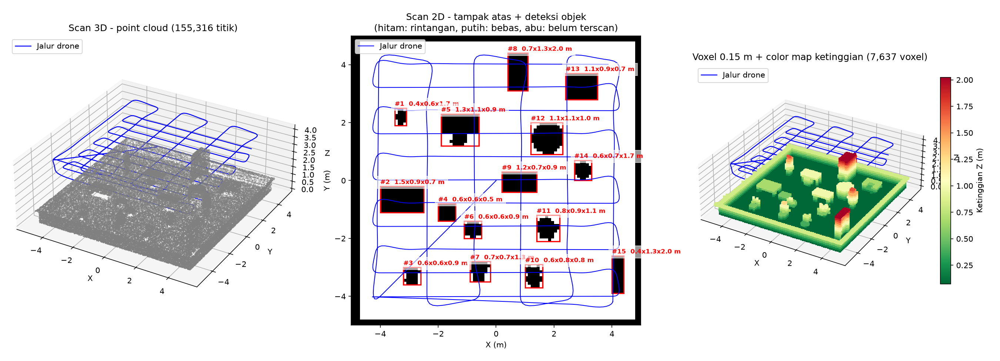
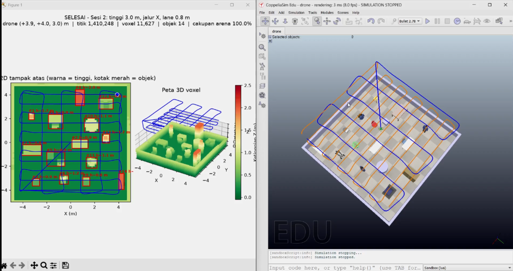
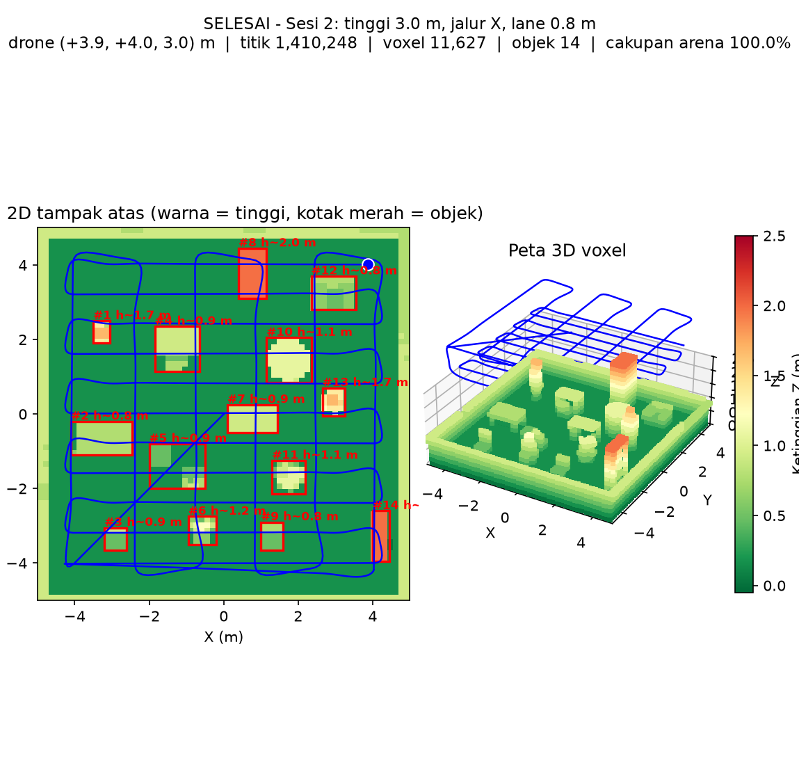

# Drone Mapping dengan CoppeliaSim

Proyek ini melakukan pemetaan arena menggunakan drone di **CoppeliaSim** dan
sensor laser 3D. Data hasil pemindaian disimpan sebagai point cloud, kemudian
diproses menjadi peta voxel 3D.

Penulis: **Muhammad Zahran Razzaq**

## Daftar Isi

- [Versi 1 — Simple](#versi-1--simple)
- [Versi 2 — Add Something](#versi-2--add-something)
- [Persiapan](#persiapan)
- [Cara Menjalankan](#cara-menjalankan)
- [Demo](#demo)
- [Laporan PDF](#laporan-pdf)

## Versi 1 — Simple

Versi ini merupakan implementasi dasar pemetaan 3D. Drone terbang mengikuti
pola lawnmower dalam dua sesi pemindaian, lalu hasilnya divisualisasikan sebagai
peta voxel 3D dengan warna berdasarkan ketinggian.

### Screenshot





### Fitur

- Pemindaian point cloud menggunakan fast 3D laser scanner.
- Dua pola sapuan drone dengan arah yang berbeda.
- Penyimpanan data ke `map_data.npz`.
- Visualisasi point cloud, voxel, atau voxel berwarna berdasarkan ketinggian.

## Versi 2 — Add Something

Versi ini mengembangkan versi simple dengan fitur tambahan:

- Preview peta secara real-time selama simulasi.
- Peta 2D tampak atas dan peta 3D voxel dalam satu jendela.
- Deteksi dan pengukuran objek secara otomatis.
- Ekspor daftar objek ke `objek.csv`.
- Ekspor point cloud berwarna ke `cloud_berwarna.ply`.
- Penyimpanan hasil visualisasi akhir ke `hasil_akhir.png`.

### Screenshot





### Contoh preview peta



## Persiapan

1. Install **CoppeliaSim Edu**.
2. Pastikan Python sudah terpasang.
3. Install dependensi Python:

   ```bash
   pip install numpy matplotlib coppeliasim-zmqremoteapi-client
   ```

4. Buka scene `drone.ttt` pada folder versi yang ingin digunakan di
   CoppeliaSim.

## Cara Menjalankan

### Versi 1 — Simple

Masuk ke folder `simple`:

```bash
cd simple
```

Jalankan scene di CoppeliaSim dalam keadaan **belum Play**, kemudian jalankan:

```bash
python mapping.py
```

Setelah pemetaan selesai, tampilkan hasil dalam mode voxel berwarna:

```bash
python view_map.py color
```

Mode visualisasi lain yang tersedia:

```bash
python view_map.py raw
python view_map.py voxel
python view_map.py color
```

Ketinggian terbang juga dapat diubah melalui argumen:

```bash
python mapping.py 3.5 1.2
```

### Versi 2 — Add Something

Masuk ke folder `add_something`:

```bash
cd add_something
```

Jalankan scene `drone.ttt` di CoppeliaSim dalam keadaan **belum Play**, lalu:

```bash
python mapping.py
```

Setelah simulasi selesai, proses hasil pemetaan:

```bash
python view_map.py
```

Perintah tersebut menghasilkan:

- `hasil_akhir.png` — visualisasi scan 3D, scan 2D, dan voxel berwarna.
- `objek.csv` — data objek yang terdeteksi beserta ukuran dan perkiraan volume.
- `cloud_berwarna.ply` — point cloud berwarna yang dapat dibuka di MeshLab atau
  CloudCompare.

Untuk mengatur ketinggian dua sesi pemindaian:

```bash
python mapping.py 3.5 1.2
```

## Demo

### Versi 1 — Simple

- YouTube: [Demo versi simple](https://www.youtube.com/watch?v=pKvikPEFEA0)
- GitHub: [SRO_ets_drone_mapping](https://github.com/zahran-rzq/SRO_ets_drone_mapping)

### Versi 2 — Add Something

- YouTube: [Demo versi add something](https://youtu.be/6ZV_slY9gPI)
- GitHub: [SRO_ets_drone_mapping](https://github.com/zahran-rzq/SRO_ets_drone_mapping)

## Laporan PDF

- [Laporan versi 1 — Simple](simple/sro_simple.pdf)
- [Laporan versi 2 — Add Something](add_something/sro_add_something.pdf)

## Struktur Folder

```text
.
├── simple/
│   ├── drone.ttt
│   ├── mapping.py
│   ├── view_map.py
│   ├── map.png
│   ├── copelia.png
│   └── sro_simple.pdf
└── add_something/
    ├── drone.ttt
    ├── mapping.py
    ├── view_map.py
    ├── objects.py
    ├── hasil_akhir.png
    ├── preview_final.png
    ├── screenshoot.png
    └── sro_add_something.pdf
```